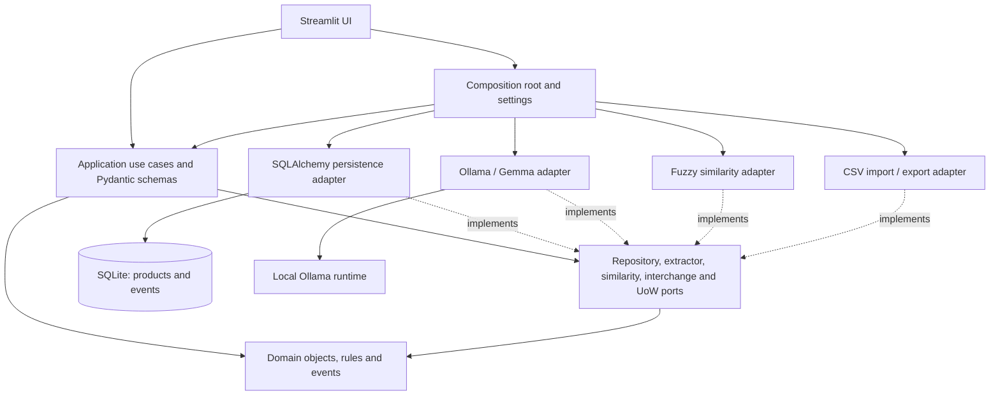

# StockEntry Guard

AI-assisted inventory product onboarding for small retailers, built for
Hacktoberfest Week 2.

**Status: Streamlit MVP, CSV import/export, and onboarding workflows are implemented.**
SQLAlchemy repositories, atomic unit of work, versioned events, Alembic migrations,
local Ollama extraction, and deterministic duplicate checking are available.
The Streamlit page exposes inventory, image extraction, duplicate review, approval,
and recent activity. Candidates are never persisted without explicit approval.

## Application workflow

After running the Alembic migration, call `build_workflows(settings)` from the
composition root. The Streamlit UI collects review edits and passes a fresh
`ProductCandidate` with `approved=True`
for create/update. Updates require the target product UUID and expected revision.
Approvals with an unblocked likely match are blocked; there is no override yet.
Each approval needs a stable, nonblank `command_id`. Reusing it with the same
reviewed request returns the original ID/revision; changing the request raises
`CommandReuseError`. A failed transaction leaves the key available for retry.
Import inventory CSV -> upload product image -> extract with local Ollama/Gemma ->
normalize -> check duplicates -> classify as NEW_PRODUCT, LIKELY_DUPLICATE, or
NEEDS_REVIEW -> review/edit -> explicitly approve create/update or reject ->
persist workflow events -> export inventory.

## Setup (Python 3.12)

Run from the repository root. PowerShell:

```powershell
py -3.12 -m venv .venv
.\.venv\Scripts\python.exe -m pip install -e ".[dev]"
Copy-Item .env.example .env
.\.venv\Scripts\python.exe -m alembic upgrade head
.\.venv\Scripts\python.exe -m streamlit run src/stockentry_guard/ui/streamlit_app.py
```

On macOS/Linux, use python3.12, .venv/bin/python, and cp instead.
Where RTK is installed, prefix commands with `rtk proxy`.
Apply the database migration before opening the UI. Inventory and activity work
without Ollama; image extraction needs the local Ollama server and configured model.

## Development checks

With the virtual environment activated:

```text
python -m ruff check .
python -m ruff format --check .
python -m pytest
python -m mypy
```

Dependencies use bounded compatible ranges in pyproject.toml. A reproducible lock
file is not supplied yet. SQLite ships with Python; no separate SQLite package
is needed. SQLAlchemy owns persistence; Alembic owns schema changes.

## Configuration

Copy .env.example to .env. Settings are loaded by Alembic and passed explicitly to
the composition root; the UI instantiates settings and services through bootstrap.

| Variable | Default |
| --- | --- |
| STOCKENTRY_DATABASE_URL | sqlite+pysqlite:///./data/stockentry_guard.db |
| STOCKENTRY_OLLAMA_BASE_URL | http://localhost:11434 |
| STOCKENTRY_OLLAMA_MODEL | gemma3:4b |
| STOCKENTRY_OLLAMA_TIMEOUT_SECONDS | 120 |
| STOCKENTRY_MAX_IMAGE_BYTES | 10485760 (10 MiB) |

The database adapter creates the configured local data directory before connecting.
Relative database paths are relative to the working directory.

## Local product extraction

Install [Ollama](https://ollama.com) separately and ensure its local server is
running (start the desktop app or use `ollama serve`). Download the default
vision-capable model:

```text
ollama pull gemma3:4b
python scripts/test_ollama_extraction.py "C:\\path\\to\\product.png"
```

The manual script reads .env/settings, sends one image to the configured model,
and prints the validated candidate and separate metadata. It writes no inventory,
events, images, or raw responses. Use --media-type image/jpeg to override MIME
inference from the extension. Failures print a typed error and exit with code 1.
Default automated tests use mocks; they never contact Ollama.

Supported MIME types: image/jpeg, image/png, image/webp. Empty images and files
above STOCKENTRY_MAX_IMAGE_BYTES are rejected before inference. No resizing,
compression, OCR fallback, or automatic retry is performed. Model generation is
capped at 1024 output tokens; truncated responses fail validation. MIME is checked at the
boundary; actual image decoding is delegated to Ollama. The timeout configures
the SDK's HTTP connect/read/write/pool timeouts, not a hard overall deadline.

AIProductExtractor.extract(image, media_type=...) returns ExtractionResult:
candidate plus confidence, uncertain_fields, model_name, prompt_version,
schema_version, and processing_ms. Confidence is a model-reported heuristic,
never a calibrated probability or approval decision. Structured output does not
guarantee factual correctness; all candidates require human review.

Prompt retail-product-v2 requests visible/supported information only, distinct
brand/name/variant, unreadable values as null, no guessed SKU/barcode/size, basic
visible unit labels, and JSON only. Extraction schema v1 forbids unknown keys,
requires bounded confidence, and restricts uncertain_fields to product fields.
Missing optional values stay null; blank strings become null. Nonblank SKU and
barcode strings retain leading zeroes. size_value must be a positive decimal
string on the wire and becomes Decimal without a float conversion. Numeric
size/identifier JSON values are rejected rather than coerced. Missing, blank, or
obvious placeholder product names fail extraction; broader semantic accuracy
still needs review. Ambiguous fields must be null, not speculative values.

PRODUCT_EXTRACTED event construction is available through
product_extracted_event(result, correlation_id). Its envelope version is 2;
the payload contains only controlled metadata, including extraction schema
version 1. Existing event version 1 remains supported. Neither the adapter nor
the helper persists events. There is no extraction_runs table.

Gemma is an open-weight model; its own terms apply.
See [Ollama's model page](https://ollama.com/library/gemma3).
Hardware latency and accuracy on actual retail photos remain deployment concerns.

## Architecture and scope

See [docs/ARCHITECTURE.md](docs/ARCHITECTURE.md) for the complete directory tree,
module boundaries, Mermaid diagram, event design, extension plan, and open questions.
See [AGENTS.md](AGENTS.md) for contributor/agent rules.

One Python modular monolith: Streamlit, SQLAlchemy/SQLite, Pydantic, and local
Ollama. Future replacements attach through ports. No microservices, analytics
dashboards, authentication, payments, or forecasting.



## Database setup

With the environment activated, run from the repository root:

```text
python -m alembic upgrade head
python -m alembic current
```

The URL comes from STOCKENTRY_DATABASE_URL or .env. Migration 0001 creates
products and workflow_events; Alembic also maintains alembic_version.
Normal startup never runs create_all or migrations. Downgrade is destructive and
should only be used on disposable test databases.

Products use UUID identity, optional string SKU/barcode, structured size/variant
fields, revision >= 1, and UTC timestamps. Names and external identifiers are
not unique database keys. Decimal sizes use lossless text storage to avoid SQLite
float conversion; numeric SQL sorting/aggregation on size is not supported.
SQLite stores UTC wall time; the adapter always returns timezone-aware UTC.

Use build_workflows(settings) for the composed application workflows, or
build_unit_of_work_factory(settings) to wire a unit of work directly. Within a
unit-of-work context, repositories stage writes; call commit() explicitly, or all
work rolls back. update(product) compares its current revision and returns the
next revision, provisional until commit. Stale updates abort the transaction.
Append the related validated WorkflowEvent in the same unit of work. Repositories
do not emit events or approve products automatically. Approval commands use a
deterministic event UUID derived from command_id. A
repeated command with identical reviewed input returns the original product ID and
revision without writing again; a reused key with different input fails.

sample_data/inventory.csv contains 18 demonstration products, including optional
identifiers and pack/variant differences. Barcodes and SKUs are synthetic fixtures,
not verified retail identifiers. Tests load this file explicitly to verify string
and Decimal round trips. The
CSV adapter accepts UTF-8 (including BOM), validates every row, reports structured
row errors, and rejects duplicate rows or repeated nonblank SKU/barcode within a
batch. Import writes all products and one INVENTORY_IMPORTED event atomically.

CSV columns are sku, barcode, name, brand, category, variant, size_value,
size_unit, description; only name is required. Export uses that column order,
valid CSV quoting, deterministic product-ID order, and spreadsheet formula
protection on output without changing stored values. Quantity, prices, costs,
and sales are out of scope.

Tests use isolated SQLite databases upgraded via Alembic. They also compare the
migration with ORM metadata and compile PostgreSQL DDL without requiring a server.
PostgreSQL runtime behavior is not yet integration-tested.

The application now exposes ImportInventory, ExtractProductFromImage,
CheckProductDuplicates, ApproveNewProduct, UpdateExistingProduct, RejectCandidate,
and ExportInventory through build_workflows(settings). The caller reviews and edits
ProductCandidate before approval. Approvals revalidate, recheck duplicates, and
commit product mutations with controlled events. The Streamlit MVP provides the UI
workflow; there is no durable review-session table.

Real-photo extraction accuracy and latency remain deployment concerns. The
default timeout is 120 seconds. No test images are committed.

## Normalization and duplicate checking

Use build_duplicate_checker(settings).execute(candidate, existing_products).
It returns DuplicateResult with classification, ranked matches, top score, top
matched product UUID, and decision reason codes. Each match includes seven
individual signal scores (None means unknown), explanations, and blockers.
The top ID is the best comparison candidate, not an approved merge target.
No model calls, database writes, automatic merges, or events occur in this operation.

Pure domain comparison views apply Unicode NFKC, case folding, punctuation-to-space
and whitespace collapse. Reviewed values are never changed. Common ml/l/g/kg
spellings normalize to ml/g for comparison using exact Decimal conversion:
0.33 l equals 330 ml, and 0.4 kg equals 400 g. One explicit measurement in the name
can supply a missing structured size; ambiguous multipacks, multiple measurements,
unsupported structured units, and contradictory size evidence block a likely result.
Identifier punctuation, case, and leading zeroes remain intact.

Text similarity is the maximum of symmetric SequenceMatcher character similarity
and shared-token count divided by the smaller token-set size. The weighted mean
uses name 0.65, brand 0.10, variant 0.08, size 0.15, category 0.02; unavailable
signals are omitted from both numerator and denominator. Exact barcode raises
the score to at least 0.99. Exact SKU adds 0.02 (capped at 1); SKU alone cannot
establish identity. Each size, variant, barcode, or brand conflict subtracts 0.15
(floor 0) and independently blocks a likely classification, regardless of thresholds.

Default thresholds are configurable:
- STOCKENTRY_DUPLICATE_REVIEW_THRESHOLD=0.60
- STOCKENTRY_DUPLICATE_LIKELY_THRESHOLD=0.85

Below review is NEW_PRODUCT; from review up to likely is NEEDS_REVIEW; at/above
likely is LIKELY_DUPLICATE only without blockers. The domain validates
0 < review < likely <= 1. Empty inventory returns NEW_PRODUCT. Without a name
or barcode, a candidate with nonempty inventory requires review. Without exact
barcode evidence, a likely match requires sufficient name similarity (engine
parameter minimum_name_similarity, default 0.60) and matching size or matching
brand plus variant. Missing signals are not agreement. Multiple unblocked matches
above the likely threshold require review. Ranking is score descending, UUID
ascending for ties, independent of inventory order.

Explicit variant strings are compared conservatively: unequal normalized variants
block likely classification. The only aliases are zero sugar -> zero and
sugar free -> sugarfree. If variant is absent, visible name markers original,
zero, sugarfree, diet, and max provide a limited fallback. Other flavors/editions
in names are not comprehensively recognized; provide structured variants.

Scores are heuristic evidence, not probabilities. Thresholds need retailer-data
calibration. Token containment can overrate generic/subset names; variant aliases,
multilingual labels, pack counts, and noisy barcodes remain risks. The current
contract has no barcode-trust flag: all nonblank supplied barcodes are treated
as trusted comparison evidence, so callers must verify extracted identifiers.
Fuzzy spelling differences in explicit brands/variants deliberately err toward
review. The adapter scans the supplied inventory in memory and is intended for
a small MVP.
