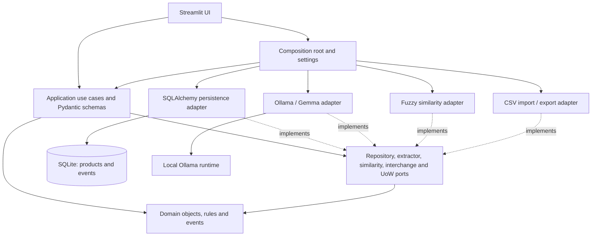

# StockEntry Guard architecture

## Overview and status

A synchronous Python 3.12 modular monolith for a single retailer's local inventory
onboarding workflow. One application process contains UI, use cases, domain, and
infrastructure adapters. Ollama is a local inference runtime, not an application
microservice. SQLite is the MVP store, accessed only through SQLAlchemy.

The product domain and SQLAlchemy persistence foundation are implemented: product
and event repositories, an atomic unit of work, version-one payload validation,
portable value adapters, and Alembic migration 0001. There are two application
tables and no review-state tables. Local Ollama extraction is implemented through
AIProductExtractor, returning an unapproved candidate plus separate metadata.
Deterministic matching and the CheckDuplicates application use case are implemented.
UI workflows, CSV parsing/validation, approval, and export remain unimplemented.

## Repository structure

Every package directory shown below has an __init__.py.

```text
.
|-- .env.example
|-- .gitignore
|-- .python-version
|-- AGENTS.md
|-- README.md
|-- pyproject.toml
|-- alembic.ini
|-- migrations/ (env.py, script.py.mako, versions/0001_products_and_workflow_events.py)
|-- sample_data/inventory.csv
|-- scripts/test_ollama_extraction.py (manual, opt-in)
|-- docs/
|   `-- ARCHITECTURE.md
|-- src/stockentry_guard/
|   |-- __init__.py
|   |-- bootstrap.py
|   |-- config.py
|   |-- domain/
|   |   |-- models.py
|   |   |-- events.py
|   |   |-- normalization.py
|   |   |-- duplicates.py
|   |   `-- errors.py
|   |-- application/
|   |   |-- schemas.py
|   |   |-- event_payloads.py
|   |   |-- extraction_schema.py
|   |   |-- extraction_events.py
|   |   `-- use_cases/ (check_duplicates.py)
|   |-- ports/
|   |   |-- repositories.py
|   |   |-- services.py
|   |   |-- extraction.py
|   |   `-- unit_of_work.py
|   |-- infrastructure/
|   |   |-- persistence/ (models.py, types.py, database.py, repositories.py, unit_of_work.py)
|   |   |-- ai/ (ollama_extractor.py, prompts.py)
|   |   |-- similarity/ (deterministic.py)
|   |   `-- inventory/
|   `-- ui/
|       `-- streamlit_app.py
`-- tests/
    |-- test_smoke.py
    |-- conftest.py
    |-- test_domain.py
    |-- test_normalization.py
    |-- test_duplicates.py
    |-- test_events.py
    |-- test_extraction.py
    |-- test_persistence.py
    `-- test_migrations.py
```

## Module responsibilities and dependency direction

| Module | Owns | May depend on |
| --- | --- | --- |
| domain | Product/candidate identity, comparison normalization, duplicate classification policy, events | Standard library only |
| ports | ProductRepository, EventRepository, AIProductExtractor, SimilarityEngine, InventoryImporter, InventoryExporter, UnitOfWork | Domain and standard library |
| application | Pydantic candidate and versioned event payload schemas; future import, extract, check, approve, reject, export use cases | Domain, ports, Pydantic |
| infrastructure/persistence | SQLAlchemy mappings, repositories, session management, Alembic migrations, unit of work | Ports, domain, SQLAlchemy |
| infrastructure/ai | Ollama request/response mapping, prompt, image limits, extraction validation | Ports, domain, application schemas, Ollama |
| infrastructure/similarity | Deterministic fuzzy scoring and match evidence | Ports, domain |
| infrastructure/inventory | Future CSV parsing/export and format errors | Ports, domain, application schemas, standard-library csv |
| ui | Streamlit rendering, input capture, display of outcomes | Application and composition root |
| bootstrap/config | Adapter construction, dependency injection, environment settings | Outer modules and configuration libraries |

Dependencies point inward. Domain imports no Pydantic, Streamlit, SQLAlchemy,
SQLite, Ollama, CSV, or environment configuration. Application never imports
infrastructure or UI. Protocols use plain domain objects rather than ORM rows,
Streamlit uploads, or provider responses. bootstrap.py is the only wiring point.
Importing a module must not contact Ollama, open a database, or start a UI.

The following arrows show source dependencies; adapters implement the ports.



## Data flow

1. **Import:** UI submits CSV bytes to an import use case. InventoryImporter
   parses and validates every row before mutation. Show row errors and an import
   preview; importing existing inventory is an explicit user action. The resolved
   policy is all-or-nothing: invalid rows produce structured errors and no writes.
   Successful batches commit products with one INVENTORY_IMPORTED event, never
   per-row PRODUCT_CREATED events. Preserve barcodes and SKUs as strings.
2. **Extract:** the implemented AIProductExtractor accepts bytes/media type and
   returns ExtractionResult(candidate, metadata), using standard-library DTOs and
   typed service errors in ports/extraction.py. The adapter validates MIME/size,
   sends the Pydantic JSON schema to Ollama, validates the completed response, and
   maps it to ProductCandidate. The application schema has no Ollama imports.
   Missing information stays unknown; invalid output never becomes a candidate.
   No adapter or UI code approves products or persists extraction events. Output
   generation is capped at 1024 tokens and incomplete responses are rejected.
3. **Normalize:** pure domain comparison views normalize Unicode, whitespace,
   punctuation, case, common unit spellings and product/brand/variant text.
   Exact Decimal unit scaling compares litres as ml and kilograms as g. A single
   measurement in a name may supply missing size; ambiguous or contradictory
   size evidence is flagged. Original reviewed values and normalized_name remain unchanged.
4. **Check:** CheckDuplicates accepts a candidate and supplied Products, calls the
   existing SimilarityEngine.find_matches port, and applies domain classification
   policy. A future caller loads Products through ProductRepository. The richer
   SimilarityMatch retains its existing ID/score/reasons and adds typed signals
   and blockers. DuplicateResult contains classification, ordered matches, top
   score, top product ID, and decision reason codes. No ORM objects or model calls
   cross the boundary. Nothing is persisted or merged by this use case.
5. **Review:** show extracted values and matches. The user can edit, select a
   target product, approve creation/update, or reject. Edits invalidate the old
   duplicate decision; normalize and recheck before approval.
6. **Approve:** revalidate approved fields and reload the selected target inside a
   short unit of work. Persistence detects stale revisions; future use cases must also detect repeated
   approval requests. Store PRODUCT_APPROVED and PRODUCT_CREATED or PRODUCT_UPDATED
   in the same transaction as the mutation. Roll back everything on failure.
   Rejection records PRODUCT_REJECTED without changing inventory.
7. **Export:** load a consistent inventory snapshot, serialize through
   InventoryExporter, and offer a CSV download. Keep encoding, column ordering,
   quoting, and spreadsheet-formula escaping inside the CSV adapter.

Use cases should return typed results/errors, not UI calls. Keep inference and
human review outside database transactions. Streamlit reruns must not repeat
writes: use stable workflow/command IDs and database uniqueness for idempotency
when workflows are implemented. Session state alone is not a durable guard.

## Persistence and events

The MVP uses current-state products plus an append-only workflow event table,
not event sourcing. Product state is authoritative for inventory queries; events
retain historical facts for audit and future analytics. SQLAlchemy mappings stay
separate from domain dataclasses.

UnitOfWork binds ProductRepository and EventRepository to one session and
transaction. Repositories stage writes without committing. Explicit commit
succeeds atomically; leaving the context without commit rolls back and closes
resources. Non-mutating workflow facts such as extraction/check outcomes use
their own short event transaction. Never record success before an operation
actually succeeds. CSV imports commit products and import events together.

WorkflowEvent includes event UUID, event type, UTC occurrence time, schema
version, correlation/workflow UUID, optional product UUID, and a scalar payload
copied into an immutable mapping. The adapter validates version-one Pydantic
payloads by event type with extra fields forbidden; PRODUCT_EXTRACTED additionally
supports version 2 for controlled extraction metadata. Arbitrary model JSON and
unknown versions are rejected before staging. Product mutation events require a
product ID. EventRepository returns ordered workflow events or StoredEvent records
through read_after(sequence, limit=...). Sequence is generated by persistence.

The products table stores UUID id; optional sku/barcode, brand/category/variant,
size_value/size_unit, description; required name/normalized_name, revision,
created_at/updated_at. UUID is the sole persistence identity. Barcode is the
strongest matching identifier but is not unique-enforced; SKU is retailer data,
and name alone never defines identity. Sizes and variants remain separate rows.
New products start at revision 1; update compares the expected revision in the
SQL WHERE clause and atomically increments it. Missing/stale updates raise
ConcurrentProductUpdateError and prevent commit, including if the caller catches
that error. Creation time and ID cannot be changed by an update.

workflow_events stores sequence (generated primary key), unique event_id, type,
correlation_id, nullable product_id, schema_version, occurred_at, and JSON payload.
The primary key indexes sequence; other indexes cover (event_type, occurred_at),
product_id, and correlation_id. products has nonunique barcode/SKU indexes.
Historical product IDs deliberately have no cascading foreign key: event history
must not depend on a current product row existing. Events are append-only through
the repository API; direct database writes are outside that guarantee.

UUID uses SQLAlchemy Uuid (native PostgreSQL UUID, SQLite character encoding).
UTCDateTime rejects naive input, normalizes offsets, and restores UTC awareness
after SQLite reads; PostgreSQL uses TIMESTAMP WITH TIME ZONE. ExactDecimal stores
decimal text without float coercion on either backend. This preserves precision
and scale but does not support numeric SQL ordering/aggregation. These are
infrastructure concerns, not SQLite-dependent domain rules.

Alembic migration 0001 defines both tables independently of live ORM metadata.
Engine creation ensures the local directory exists but never mutates schemas.
Tests upgrade isolated SQLite databases and check migration/metadata agreement.
SQLAlchemyUnitOfWork uses one session/transaction, explicit commit, rollback on
failure/uncommitted exit, and unconditional session close. A unit of work is
single-use; returned updated objects are provisional until commit.

| Event | When future use case emits it | Payload fields (v1 unless noted) |
| --- | --- | --- |
| INVENTORY_IMPORTED | Successful committed import | accepted_count, source_fingerprint; batch identity uses correlation_id |
| PRODUCT_EXTRACTED | Successful validated extraction | v1: model_tag, prompt_version, missing_field_count; v2: model_name, prompt_version, schema_version, confidence, uncertain_field_count, processing_ms |
| DUPLICATE_CHECKED | Completed classification | classification, engine_version, threshold_version, top_score |
| DUPLICATE_FOUND | Check identifies likely duplicate(s) | matched_product_id, score, reason_code |
| PRODUCT_APPROVED | Accepted explicit user decision | action, reviewed_revision, command_id |
| PRODUCT_CREATED | Product insert succeeds | revision (1); onboarding only |
| PRODUCT_UPDATED | Product update succeeds | previous_revision, revision (consecutive) |
| PRODUCT_REJECTED | User rejects candidate | reason_code (optional) |

Import emits only one INVENTORY_IMPORTED event for the batch. PRODUCT_CREATED is
reserved for onboarding. Rich before/after snapshots would require a future
payload version; current events support workflow counts/timing, not historical
attribute reconstruction. Never store raw images, prompts, or secrets in events.
Image retention remains unresolved. Repositories do not automatically generate
events: future application use cases must pair mutations with appropriate facts.

## Local extraction boundary

The return-type refinement from ProductCandidate to ExtractionResult preserves
the ports/adapters boundary and keeps provider metadata out of Product.
Metadata includes model-reported confidence (not calibrated probability), known
uncertain field names, configured model name, prompt version, extraction schema
version, and elapsed milliseconds. Typed failures distinguish MIME/size/empty
input, unavailable service, timeout, provider failure, invalid/incomplete response,
malformed JSON, schema errors, and missing product identity.

Prompt retail-product-v1 asks for supported visual facts, null unknowns, no
invented identifiers or sizes, separate brand/base name/variant, and JSON only.
The image text is treated as data. Pydantic extraction schema v1 forbids extras;
strict string identifiers retain zeroes and decimal strings convert directly to
Decimal. Ambiguous fields must be null. Confidence outside 0..1 is rejected.
There is no output repair, duplicate detection, image resizing, or fallback
candidate. Unsupported/oversized inputs are rejected before calling the SDK.

bootstrap.build_product_extractor(Settings) owns configuration. The default model
remains in Settings, and the adapter has no hard-coded model choice. The SDK lives
only under infrastructure/ai. The default 10 MiB byte limit is configurable using
STOCKENTRY_MAX_IMAGE_BYTES. HTTP timeouts are per operation, not a total deadline.

application.extraction_events.product_extracted_event creates a version-two
envelope with allowlisted metadata only; extraction schema_version in the payload
is independently versioned (currently 1). No raw images, responses, prompts,
candidate attributes, or secrets are persisted. No schema migration or new table
is needed. Existing version-one event validation remains compatible. Event
persistence and human approval belong to later application use cases.

## Deterministic matching policy

The port still returns ranked match evidence; the application orchestrates and
the domain owns thresholds/classification. bootstrap.build_duplicate_checker
injects the adapter and DuplicateThresholds from Settings. No architecture
boundary changes, fuzzy-library dependencies, persistence changes, or AI changes
were required.

For each available text signal, the adapter takes the maximum of symmetric
SequenceMatcher ratio and token overlap divided by the smaller token-set length.
The weighted mean is name .65, brand .10, variant .08, size .15, category .02;
unknown pairs are omitted, not treated as exact matches. Barcode exact sets a
minimum .99; SKU exact adds .02 capped at 1. Each size/variant/barcode/brand
conflict subtracts .15 (floor 0) and adds an independent likely-match blocker.
Identifiers remain exact strings, preserving leading zeroes.

Review and likely thresholds default to .60 and .85, respectively, configurable
through STOCKENTRY_DUPLICATE_REVIEW_THRESHOLD and
STOCKENTRY_DUPLICATE_LIKELY_THRESHOLD. Threshold intervals are [0, review),
[review, likely), and [likely, 1]. Blocked scores at/above likely yield review,
not likely; scores below review are new except missing candidate identity, which
requires review when inventory exists. No inventory returns new. Without exact
barcode evidence, sufficient name similarity (adapter constructor parameter,
default .60) plus size agreement or brand+variant agreement is required for likely.
More than one unblocked likely match yields review. Ordering is descending score,
then ascending UUID, independent of input order. Every result remains advisory.

Supported size units are ml/l/g/kg with common English spellings; conversion uses
Decimal without float rounding. Name-only pack/multiple-size ambiguity, invalid
structured units, and structured/name contradictions block likely results.
Variants normalize punctuation/case and two aliases (zero sugar -> zero,
sugar free -> sugarfree). Absent variants use only a small visible name marker
set: original, zero, sugarfree, diet, max. Unequal known variants and brands are
conservatively blocked even if fuzzy text is close. No broad semantic knowledge
or universal SKU identity is claimed.

See README for the full formula and example usage. Matching remains heuristic:
generic token subsets, unseen variants, multilingual units, and unverified
barcodes need evaluation on retailer data. The current port has no trust flag;
nonblank barcodes are treated as trusted supplied evidence. No automatic merge
or inventory write follows from LIKELY_DUPLICATE.

## Extension points

- **SQLite -> PostgreSQL:** implement the same repositories/UoW with SQLAlchemy,
  add the PostgreSQL driver, migrations, and dialect integration tests. A URL swap
  alone does not prove portability: test JSON, timestamps, UUIDs, constraints, and
  concurrency. Alembic now manages schema evolution; test each new dialect migration.
- **Streamlit -> web frontend:** expose use cases through an HTTP layer; keep
  transport schemas separate and reuse domain/ports. No API server is needed now.
- **Fuzzy -> embeddings/vector search:** replace SimilarityEngine, preserving
  ranked evidence and normalized score semantics. The current inventory sequence
  parameter suits a small MVP; indexed retrieval at larger scale may justify a
  separate retrieval port. Recalibrate classification policy for a new engine.
- **Ollama/Gemma -> another provider:** replace AIProductExtractor. Keep model
  prompts, transport timeouts, response parsing, and provider errors in adapters.
  Initial model is gemma3:4b, a vision-capable open-weight Gemma model.
- **CSV -> another format:** replace importer/exporter; domain remains unaware of
  bytes, columns, delimiters, and file names.

## Analytics extension path

Later, add a read-side projection/job consuming committed events in sequence
order. Checkpoint its last sequence, deduplicate by event UUID, and rebuild
projections from versioned historical events. Sequences may have gaps and represent
allocation order, not universal commit order: concurrent PostgreSQL transactions
can commit out of sequence. Before adding live PostgreSQL projections, use an
outbox/delivery checkpoint protocol that cannot skip a late commit. The current
SQLite MVP serializes writes. Start with import counts,
classification outcomes, review/rejection rates, and elapsed workflow time by
correlation ID. These require all workflow events to be emitted consistently from
the first functional release. Payload versioning allows old events to remain
readable as new fields are introduced.

Analytics reads events and writes its own derived tables; it never drives product
approval rules or mutates historical events. An external consumer can be added
later via a transactional outbox if needed. No broker, dashboard, distributed
event bus, or analytics implementation is part of this scaffold.

## Open questions and deliberate deferrals

- CSV encoding, structured error format, and handling conflicts with existing
  external identifiers. Columns are resolved: sku, barcode, name, brand, category,
  variant, size_value, size_unit, description. Only name is required in CSV;
  normalized_name and identity/timestamps are assigned after validation.
  Quantity, price, cost, currency, suppliers, reorder levels, and sales are excluded.
- Retailer-specific threshold calibration, generic-name false positives, variant
  vocabulary coverage, barcode trust, and labeled data for false-positive/negative evaluation.
- Target hardware, chosen Gemma quantization, acceptable inference latency.
- Image retention and command-idempotency storage. Durable review sessions are
  explicitly deferred; no workflow-state, extraction-run, or duplicate-check
  tables exist. Transient Streamlit state must never be the write-idempotency guard.
- PostgreSQL runtime integration and any future numeric size-query requirements.
- Distribution license and dependency locking strategy.

These do not block this foundation. Implement remaining workflows and
calibrate matching before presenting recommendations to users. Candidate data
remains separate from Product and is never persisted automatically.

## References

- [SQLAlchemy session transactions](https://docs.sqlalchemy.org/en/20/orm/session_basics.html):
  transaction lifecycle informs the planned UoW adapter.
- [Ollama Gemma 3 tags](https://ollama.com/library/gemma3/tags):
  verify vision support and available model tags before inference implementation.
